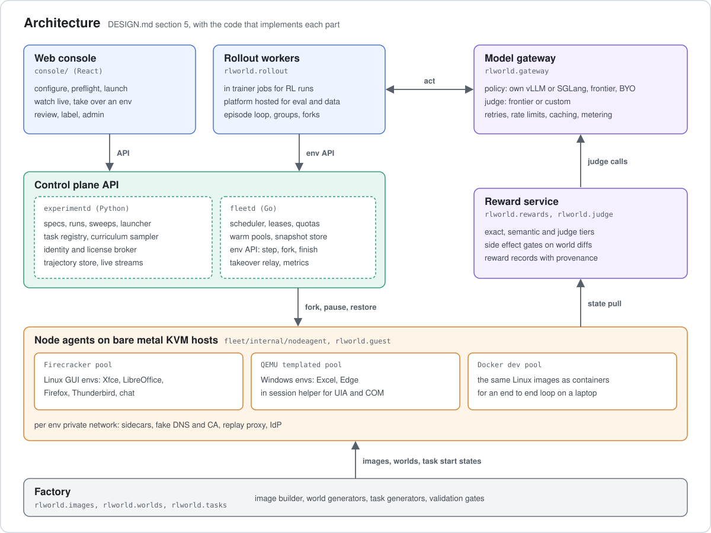

# divergent



divergent manufactures, runs, scores and replays worlds for training and evaluating computer use agents. It launches
Linux and Windows microVMs from content addressed specs, seeds them with coherent synthetic companies (mail, files,
chat, identities), lets any policy endpoint drive them and grades every episode with verifiers plus judge endpoints.

[`docs/DESIGN.md`](docs/DESIGN.md) is the design and [`docs/TASKS.md`](docs/TASKS.md) tracks how it was built. The code
calls itself `rlworld`: the Python package, the Go module, the CLIs and the metrics all use that name.

Today the Docker loop on a laptop runs end to end with a real model. The Firecracker and QEMU backends, Windows envs
and the training plumbing are built and unit tested against fakes. App clones such as Odoo and Mattermost are not
built yet (task 46).

## Layout

| Path | What lives there |
| --- | --- |
| `fleet/` | Go, standard library only. `fleetd` serves the env API: leases, admission, scheduling, the node agent, the Firecracker, QEMU and Docker drivers, snapshots, warm pools and operator takeover. `egressproxy` enforces an env's egress allowlist. |
| `python/` | The `rlworld` package: specs and preflight, `experimentd` (experiments, runs, rewards, review), the SDK and the `rlworld` CLI, model gateway adapters, world and task generators, verifiers, the Linux guest agent, the Windows in session helper and the image builders. |
| `console/` | The web console, React on Vite. |
| `schemas/` | Shared contracts the Python, Go and TypeScript code is tested against: the spec JSON schema, the API operations and the metrics catalog. |
| `examples/` | Specs, laptop configs for fleetd and experimentd, model endpoints and a judge rubric. |
| `observability/` | The Prometheus scrape config, Grafana provisioning and the platform health dashboard. |
| `docs/` | `DESIGN.md`, `TASKS.md` and the architecture diagram above. |

## What to install

For development (tests, the CLI, the console):

* [uv](https://docs.astral.sh/uv/getting-started/installation/), which installs Python 3.12 and every Python
  dependency itself.
* [Go](https://go.dev/dl/) 1.25.5 or newer.
* [Node.js](https://nodejs.org/) 22.12 or newer, with npm.

To run episodes on a laptop:

* Docker Desktop with at least 4 GB of memory and 10 GB of free disk. The images are linux/amd64, so on Apple
  Silicon keep "Use Rosetta for x86_64/amd64 emulation on Apple Silicon" switched on in Docker Desktop's settings.
* An [OpenRouter](https://openrouter.ai/) API key on an account with credits, for the reference policy. Any policy
  behind an OpenAI compatible API, such as [vLLM](https://docs.vllm.ai/), works too.

For VM hosts, Linux with KVM:

* iproute2, iptables and a filesystem with reflinks (XFS or btrfs) for disk overlays.
* Firecracker and its jailer for the Linux pool.
* QEMU 9 or newer (`qemu-system-x86_64`, `qemu-img`) for the Windows pool.
* For image builds: Docker with buildx and e2fsprogs (`mke2fs`) for Linux; Packer and bsdtar for Windows.
* Optional: mitmproxy (`mitmdump`) to record and replay web traffic; Prometheus and Grafana for dashboards.

## Set up

```bash
git clone https://github.com/srikarappal/divergent-worlds.git
cd divergent-worlds
(cd python && uv sync)
(cd fleet && go build ./...)
(cd console && npm install)
```

Put the OpenRouter key in `.env` at the repo root, which git ignores:

```bash
echo 'OPENROUTER_API_KEY=<your key>' > .env
```

## Run the tests

```bash
(cd python && uv run pytest)
(cd fleet && go vet ./... && go test -race ./...)
(cd console && npm run typecheck && npm test)
```

None of them needs Docker, KVM or a model: VMs, containers and endpoints are faked.

## Run an episode on a laptop

fleetd's Docker driver serves the Linux pool as containers (build decision 4 in `docs/TASKS.md`), so the whole loop
runs on one machine: fleetd on port 8700, experimentd on 8080 and the console on 5173. The laptop configs fit two envs
of 1.5 GB in 3.5 GB of Docker memory. Other containers share that memory and envs miss their 2 minute boot limit
when Docker runs short, so stop the containers you don't need first.

### 1. Build the dev image of the reference task

[`examples/specs/reconcile_invoices_linux.yaml`](examples/specs/reconcile_invoices_linux.yaml) is the reference task:
reconcile a month of invoices in LibreOffice Calc, then mail a summary from Thunderbird. Its image is an Xfce desktop
with LibreOffice Calc, Writer and Impress, Firefox, Thunderbird on the world's mail and a chat app on the world's chat.
Every input is pinned: the base image by digest, apt by a dated snapshot mirror in
[`examples/images/laptop.yaml`](examples/images/laptop.yaml) and Mozilla's downloads by sha256 in
[`examples/images/lock.yaml`](examples/images/lock.yaml).

```bash
cd python
uv build --wheel
uv export --extra guest --no-dev --no-emit-project --output-file dist/guest.txt
uv run rlworld-build-image ../examples/specs/reconcile_invoices_linux.yaml \
    --config ../examples/images/laptop.yaml --lock ../examples/images/lock.yaml \
    --work-dir /tmp/rlworld/build --target dev
```

The first build takes about 15 minutes and makes a 3 GB image, `rlworld-dev/noble_office_v1:3851930bad26`; later
builds reuse the package layer. The image's tag and digest come from the spec's image section, so an unchanged spec
builds the tag that [`examples/experimentd/laptop.yaml`](examples/experimentd/laptop.yaml) lists under
`static_snapshots`. After changing the spec's image, copy `image_digest` and `image_tag` from
`/tmp/rlworld/build/manifest.json` into that file. After changing guest code (`rlworld.guest`, `rlworld.images`),
rerun all three commands: the tag stays the same while the image picks up the new wheel.

### 2. Start the services

```bash
# terminal 1: fleetd
cd fleet && go run ./cmd/fleetd -config ../examples/fleetd/laptop.json

# terminal 2: experimentd, whose secrets come from the environment
cd python
set -a && . ../.env && set +a
export RLWORLD_SECRET_OPENROUTER="$OPENROUTER_API_KEY"
export RLWORLD_RUN_TOKEN_SECRET=$(openssl rand -hex 32) RLWORLD_JUDGE_SECRET=$(openssl rand -hex 32)
uv run rlworld-experimentd --config ../examples/experimentd/laptop.yaml

# terminal 3: the console at http://localhost:5173
cd console && npm run dev
```

The reference spec plays Qwen3.8 Flash on OpenRouter, as
[`examples/experimentd/endpoints.yaml`](examples/experimentd/endpoints.yaml) registers it. A running experimentd also
takes the key from stdin: `pbpaste | uv run rlworld endpoints set-key openrouter`. To play a model you serve yourself,
such as `vllm serve <model> --served-model-name my_policy --port 8000`, set the spec's policy endpoint to
`local_policy`.

### 3. Check the task, then play it

```bash
cd python
uv run rlworld specs save ../examples/specs/reconcile_invoices_linux.yaml    # prints the spec's digest
uv run rlworld specs preflight <digest>                                     # validates and estimates the cost
uv run rlworld authoring start <digest>                                     # prints a session id
uv run rlworld authoring gates <session id>                                 # replays the scripted solution
uv run rlworld specs dry-run <digest>                                       # one episode with the policy
```

The gates need no model: the oracle and rerun gates play the task's scripted solution in fresh envs and should score
1.0. The dry run prints its run and episode ids; it takes about 20 minutes and 45 steps and costs under 0.10 USD on
OpenRouter. Watch it at `http://localhost:5173/runs/<run id>/episodes/<episode id>`. Once it ends, add `/review` to that
address to scrub through every step: the screenshot with the actions marked, the model's reasoning and reply, the
state changes and the exact model input. The Runs page lists launched runs only, not dry runs.

To launch the eval run, four episodes two at a time and capped at the budget:

```bash
uv run rlworld specs launch <digest> --budget-usd 5
uv run rlworld runs list
```

Trajectories land in `data/trajectories` at the repo root, which git ignores: `runs/<run>/episodes/<episode>/`
holds each episode and its steps and `blobs/` the frames. `uv run rlworld --help` lists every command.
`RLWORLD_API_URL` points the CLI and the console at another experimentd; `RLWORLD_FLEET_URL` points the console at
another fleetd.

### 4. Stop

Press Ctrl C in each terminal. fleetd removes an env's container when its episode ends; to clear containers a crash
left behind:

```bash
docker rm --force $(docker ps --all --quiet --filter label=rlworld.env)
```

### Troubleshooting

* Envs fail to boot within 2 minutes: Docker is short of memory. Check `docker stats` and stop other containers.
* OpenRouter answers 401: the key in `.env` is wrong or revoked. A 402 means the account is out of credits.
* experimentd keeps experiments and runs in memory, so a restart forgets launched runs. Their trajectories stay in
  `data/trajectories` and the review pages still open them.
* Dev containers can reach the internet; the egress allowlist applies only to VM hosts so far.

## Dashboards

[`observability/prometheus/prometheus.yml`](observability/prometheus/prometheus.yml) scrapes `/metrics` on hosts named
`fleetd` and `experimentd`; on a laptop change the targets to `127.0.0.1:8700` and `127.0.0.1:8080`. Grafana takes
`observability/grafana/provisioning` as its provisioning directory and loads the dashboards in
`observability/grafana/dashboards`, mounted at `/var/lib/grafana/dashboards/rlworld`.

## Windows pool

Windows hosts run fleetd with `"driver": "qemu_templated"` and a `qemu` section naming `qemu_path`, `run_dir`,
`machine_type` and `cpu_model`. Screens, input and the clock stay at the hypervisor. The in session helper,
`rlworld-windows-helper` from the `windows` extra, serves UIA trees, Excel through COM, injection and extraction over a
virtio serial port. Windows images come from `rlworld-build-image --target vm` with a `windows` build config and Packer.
